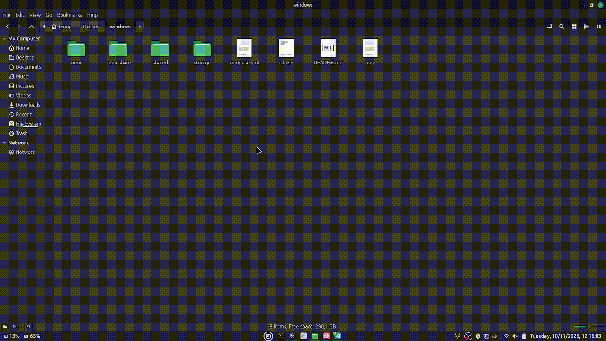

# Windows 10 và Office LTSC 2024 trong Docker

Repo này dựng máy ảo Windows 10 chạy trong Docker trên Linux, dựa trên [dockur/windows](https://github.com/dockur/windows). Ở lần chạy đầu tiên, máy ảo tự cài Word, Excel và PowerPoint, sau đó tắt các thành phần Windows không cần cho việc soạn thảo văn bản.



## 1. Cấu trúc thư mục

```
win10-docker/
├── compose.yml                   Cấu hình container Windows
├── .env.example                  Mẫu tài khoản đăng nhập Windows
├── rdp.sh                        Kết nối Remote Desktop
├── assets/
│   └── demo.gif                  Ảnh minh họa trong README
├── oem/                          Script chạy bên trong Windows ở lần cài đầu
│   ├── install.bat               Chạy một lần ở lần đăng nhập đầu tiên
│   ├── office/
│   │   └── office-ltsc2024.xml   Cấu hình cài Office
│   └── scripts/
│       ├── common.ps1            Các hàm dùng chung
│       ├── optimize.ps1          Tối ưu Windows
│       └── office.ps1            Cài Office bằng Office Deployment Tool
├── shared/                       Ổ Z: của Windows, dùng để trao đổi file
└── storage/                      Ổ đĩa ảo của Windows, tạo ở lần chạy đầu
```

## 2. Thành phần của máy ảo

- Hệ điều hành là Windows 10 IoT Enterprise LTSC 2021. Đây là bản Windows 10 không có Microsoft Store và các ứng dụng cài sẵn. Microsoft cập nhật bảo mật cho bản này đến tháng 01/2032.
- Bộ Office là Office LTSC Professional Plus 2024 bản 64-bit, giao diện tiếng Anh. Bộ cài chỉ gồm Word, Excel, PowerPoint và công cụ kiểm tra chính tả tiếng Việt.
- Máy ảo dùng 4 nhân CPU và 4 GB RAM. Khi máy chạy Docker thiếu RAM, máy ảo trả bớt RAM nhưng luôn giữ tối thiểu 2 GB.
- Ổ đĩa ảo có dung lượng tối đa 64 GB. File ổ đĩa chỉ chiếm phần dung lượng mà Windows thực dùng, khoảng 16 GB sau khi cài.
- Script tối ưu tắt hiệu ứng đồ họa, telemetry, Windows Search và SysMain. Script cũng giảm mức dùng CPU khi Microsoft Defender quét, gỡ OneDrive và đặt múi giờ UTC+7. Office được tắt hardware acceleration vì máy ảo không có GPU.
- Các port của máy ảo chỉ mở trên địa chỉ 127.0.0.1, nên chỉ máy chạy Docker truy cập được. Microsoft Defender và Windows Firewall vẫn hoạt động. UAC được bật lại sau khi cài xong.

## 3. Yêu cầu

- Máy Linux hỗ trợ KVM. Kiểm tra bằng lệnh `ls /dev/kvm`.
- Docker và Docker Compose.
- Ổ đĩa còn trống khoảng 30 GB và RAM từ 8 GB trở lên.
- Bản quyền Windows và Office LTSC 2024. Bản quyền Office có thể là MAK key hoặc KMS server của tổ chức.

## 4. Cài đặt

```bash
git clone https://github.com/tynnpdhsp/win10-docker.git
cd win10-docker
cp .env.example .env
docker compose up -d
```

Trước khi chạy `docker compose up -d`, sửa file `.env` để đặt tên và mật khẩu đăng nhập Windows. Tài khoản này chỉ được dùng ở lần cài đầu tiên.

Mặc định máy ảo chỉ cài Word, Excel và PowerPoint. Muốn cài thêm ứng dụng, xóa dòng `ExcludeApp` của ứng dụng đó trong file `oem/office/office-ltsc2024.xml` trước lần chạy đầu tiên. Ví dụ, xóa dòng `<ExcludeApp ID="Outlook" />` để cài thêm Outlook.

Lần chạy đầu mất khoảng 20 đến 60 phút, tùy tốc độ mạng. Thời gian này gồm việc tải khoảng 5 GB bộ cài Windows, cài Windows, tải khoảng 3 GB Office và cài Office. Theo dõi tiến trình bằng lệnh `docker compose logs -f` hoặc xem màn hình tại <http://127.0.0.1:8006>. Khi cài xong, Windows tự khởi động lại một lần. Log cài đặt nằm trong thư mục `shared/_setup-logs/`.

## 5. Kết nối vào Windows

Có hai cách kết nối vào Windows:

- Trình duyệt: mở <http://127.0.0.1:8006>. Cách này không cần cài thêm chương trình.
- Remote Desktop: cài FreeRDP bằng lệnh `sudo apt install freerdp3-x11`, sau đó chạy `./rdp.sh`. Cách này hiển thị nhanh hơn, cho phép copy/paste giữa hai máy và tự đổi độ phân giải theo cửa sổ. Tham số `/f` cho phép mở toàn màn hình. Các thư mục Documents, Downloads và Desktop của Linux hiện trong mục This PC của Windows.

## 6. Trao đổi file

Thư mục `shared/` trên Linux là ổ `Z:` trong Windows. Desktop của Windows có shortcut `Shared` trỏ tới thư mục này.

## 7. Kích hoạt bản quyền

Office tự kích hoạt nếu mạng có KMS server của tổ chức. Nếu không có KMS server, mở Command Prompt bằng Run as administrator trong Windows rồi chạy các lệnh sau:

```bat
cd "C:\Program Files\Microsoft Office\Office16"
cscript ospp.vbs /inpkey:XXXXX-XXXXX-XXXXX-XXXXX-XXXXX
cscript ospp.vbs /act
cscript ospp.vbs /dstatus
```

Khi dùng KMS server khác, thay lệnh `/inpkey` bằng lệnh `cscript ospp.vbs /sethst:<kms-server>`. Windows được kích hoạt bằng lệnh `slmgr /ipk <key>`, sau đó là lệnh `slmgr /ato`.

Có thể tham khảo xem thêm cách kích hoạt từ repo của massgravel [tại đây](https://github.com/massgravel/Microsoft-Activation-Scripts) (không khuyến khích).

## 8. Gõ tiếng Việt

Windows có sẵn bàn phím Vietnamese Telex. Thêm bàn phím này theo đường dẫn Settings → Time & Language → Language → Add a language → Tiếng Việt → Options → Add a keyboard. Tổ hợp phím `Win + Space` dùng để chuyển bàn phím. Cũng có thể cài UniKey hoặc EVKey.

## 9. Quản lý máy ảo

| Công việc | Lệnh |
|---|---|
| Khởi động máy ảo | `docker compose up -d` |
| Dừng máy ảo an toàn | `docker compose stop` |
| Xem log | `docker compose logs -f` |
| Xóa máy ảo | `docker compose down && sudo rm -rf storage` |

- Để đổi RAM hoặc số nhân CPU, sửa `RAM_SIZE` hoặc `CPU_CORES` trong `compose.yml` rồi chạy lại `docker compose up -d`.
- Để tăng dung lượng ổ đĩa, đặt `DISK_SIZE` lớn hơn, sau đó mở rộng phân vùng C: trong Disk Management của Windows.
- Để sao lưu, dừng máy ảo rồi chép thư mục `storage/`.

## 10. Cập nhật Windows

dockur tạm dừng Windows Update để máy ảo chạy nhẹ và không bị ngắt khi đang cài bản cập nhật. Office vẫn tự cài các bản vá bảo mật. Nên cập nhật Windows định kỳ theo các bước sau:

1. Mở Settings → Update & Security, chọn Resume updates.
2. Cài xong bản cập nhật thì khởi động lại từ trong Windows.
3. Đợi Windows khởi động xong rồi mới chạy `docker compose stop`.

## 11. Ghi chú

Repo này dựa trên [dockur/windows](https://github.com/dockur/windows) (giấy phép MIT). Repo không chứa file cài đặt hay key bản quyền. File ISO Windows do dockur tải về và kiểm tra checksum. Office được tải từ server của Microsoft.
